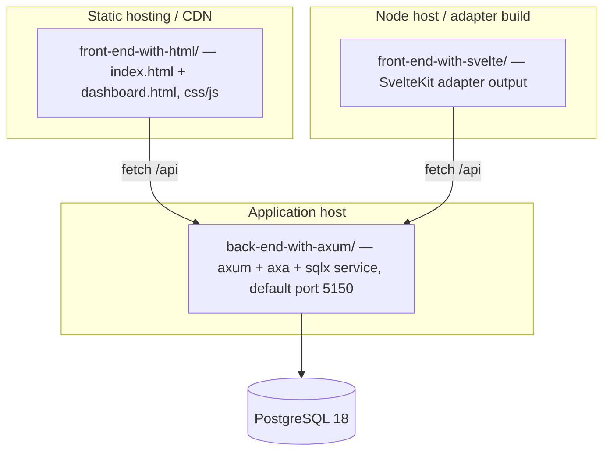

# 7. Deployment View

## 7.1 Status: hosted deployment is out of scope today

Hosted deployment, infrastructure, authentication, and multi-tenancy are
explicitly **out of scope** for the current repository (`spec.md` §2). The
monorepo demonstrates the *design* across many domains; it does not ship a
running service. There is deliberately **no unified backend** — each form's
Axum crate is independently buildable and deployable.

This section therefore describes the **intended deployment shape** per form, so
the design is deployment-ready, without asserting that any environment exists.

## 7.2 Intended per-form deployment shape

Each form is three deployable artefacts plus a database, all independent:

| Artefact | Build | Runtime shape |
| -------- | ----- | ------------- |
| **HTML front-end** | none (no build step) | Static files served over HTTP or `file://`; self-contained; talks to the API via `fetch /api/...` with a sample-data fallback. |
| **Svelte front-end** | SvelteKit adapter build (`pnpm build`) | Adapter output (static or Node) served under `/<slug>/`; client-only SVAR grid on the dashboard route. |
| **Axum back-end** | `cargo build --release` | axum service (default port 5150); one crate per form; JSON API only. |
| **Database** | sqlx migrations (`cargo run -- db migrate`) | PostgreSQL 18; per-form databases `<slug_snake>_{development,test,production}`; production URL from `DB_URL`. |
| **Observability** | built into each crate | Structured logs, and `/_health/live`, `/_health/ready` (which names a failed database or queue) and `/_health/startup`. No metrics or trace export. |

## 7.3 Configuration

Each form's settings come from the environment, with defaults in code
(`APP_ENV`, `DB_URL`, `PORT`, `HOST`, `CORS_ALLOWED_ORIGINS`).
The Postgres-backed background queue reuses the main database URI; axa creates
its own `axa_queue` table on first start. Test config runs workers
`ForegroundBlocking` so queued jobs execute inline.
